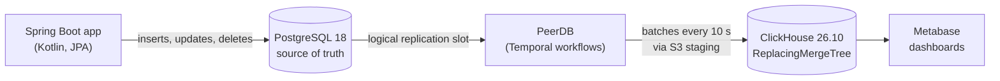

# Banking Operation House

[](https://github.com/OrionWambert/banking-operation-house/actions/workflows/ci.yml)

Real-time analytics on banking operations: a Spring Boot / Kotlin service writes to **PostgreSQL**, **PeerDB** streams every change to **ClickHouse** through change data capture (CDC), and **Metabase** serves the dashboards. The transactional database never runs an analytical query.



## Why

PostgreSQL is built for transactions: many small reads and writes, constraints, consistency. Aggregating millions of rows for a dashboard on that same database competes with the application for the same resources. ClickHouse stores data by column and compresses it, so scanning and grouping millions of rows is cheap. CDC keeps it in sync without the application knowing it exists: no dual writes, no batch export jobs.

## Results

Measured on a Windows 11 laptop (Docker Desktop, 32 GB RAM) with 5,000,000 operations:

| | |
|---|---|
| Dashboard queries in ClickHouse (with `FINAL` deduplication) | 17 ms (count), 78 ms (top 10 clients), 161 ms (operations per day and type) |
| Storage for the same rows | PostgreSQL 472 MB, ClickHouse 118 MB compressed (340 MB uncompressed) |
| Replication delay for an insert, update or delete | about 10 s (the mirror's sync interval) |
| Replication under load (seeder inserting ~2,000 rows/s) | ClickHouse stayed within ~30,000 rows of PostgreSQL, then caught up to the exact count |

## Stack

| Component | Version | Role |
|---|---|---|
| Kotlin / Spring Boot | 2.3.20 / 4.2.0 (Java 25) | Writes operations through JPA, schema managed by Flyway 12 |
| PostgreSQL | 18 | Source of truth, `wal_level=logical` |
| PeerDB | 0.37.17 | Postgres → ClickHouse CDC: initial snapshot, then streaming from a replication slot |
| ClickHouse | 26.10 | Analytical copy |
| Metabase | 0.65.6.3 | Dashboards, provisioned through its API |
| Testcontainers | 2.0.5 | Integration tests against a real PostgreSQL 18 |

## Running it

Requirements: Docker with Compose v2, JDK 25, Python 3 for the Metabase provisioning, and bash (Git Bash on Windows). The full stack is 15 containers; plan for several GB of memory (Metabase alone uses about 1.6 GB).

```bash
# 1. Start PostgreSQL, ClickHouse, PeerDB (profile cdc) and Metabase (profile bi)
docker compose --profile cdc --profile bi up -d --wait

# 2. Run the app: applies the Flyway migration and seeds 1,000,000 synthetic operations
./gradlew bootRun
#    or more: ./gradlew bootRun --args='--app.seed.count=5000000'

# 3. Create the PeerDB peers and the CDC mirror (initial copy, then streaming)
bash scripts/setup-cdc.sh

# 4. Set up Metabase: admin account, ClickHouse connection, dashboard
MB_ADMIN_EMAIL=you@example.com MB_ADMIN_PASSWORD='choose-one' python metabase/provision.py
```

Steps 3 and 4 can be run again safely: they update what exists instead of duplicating it.

| Service | URL | Credentials |
|---|---|---|
| Metabase | http://localhost:3002 | the ones passed to `provision.py` |
| PeerDB UI | http://localhost:3001 | none |
| ClickHouse console | http://localhost:8124/play | `banking` / `banking` |
| PostgreSQL | `localhost:5434`, database `banking` | `banking` / `banking` |
| Temporal UI (PeerDB workflows) | http://localhost:8085 | none |

Host ports can be changed with environment variables (`POSTGRES_PORT`, `CLICKHOUSE_HTTP_PORT`, `CLICKHOUSE_NATIVE_PORT`, `PEERDB_PORT`, `PEERDB_UI_PORT`, `TEMPORAL_UI_PORT`, `PEERDB_STAGING_CONSOLE_PORT`, `METABASE_PORT`). The app finds PostgreSQL through Spring Boot's Docker Compose support, whatever the port.

To stop everything while keeping the data: `docker compose --profile cdc --profile bi stop`.

## How the replication works

1. **Source.** PostgreSQL runs with `wal_level=logical`. `banking_operation` has a primary key, which PeerDB needs as the replica identity.
2. **Snapshot, then stream.** `scripts/setup-cdc.sh` creates a mirror through PeerDB's SQL interface. PeerDB copies the existing rows, then reads the replication slot and applies the changes every 10 seconds.
3. **Destination.** PeerDB writes to `banking.public_banking_operation`, a `ReplacingMergeTree` ordered by `id`. Each change is a new row version (`_peerdb_version`), and deletes set `_peerdb_is_deleted = 1`.
4. **Reading.** ClickHouse merges versions in the background. Until it has, queries use `FINAL` and filter on `_peerdb_is_deleted = 0` to see each operation once, in its latest state. The dashboard has a card showing how many versions are still waiting to be merged.

PeerDB's orchestration (retries, resumption after a restart, pausing a mirror) runs on Temporal, which is why the `cdc` profile includes it.

## Dashboard

`metabase/provision.py` builds one dashboard, in French, *Opérations bancaires*, and makes it the Metabase home page:

- operations, total volume, net balance (credits − debits), active clients;
- daily activity, credit/debit split, monthly volume and net balance, top clients, amount distribution, activity by hour, latest operations;
- filters on period, operation type and client, applied to every business card;
- a CDC health section: last sync, rows synced in the last hour, versions not merged yet, throughput per minute.

It also removes Metabase's sample content, hides PeerDB's internal tables and gives the columns readable names. Amounts are formatted in CFA francs (XAF).

## Project layout

```
src/main/kotlin/.../operation/   BankingOperation entity and repository
src/main/kotlin/.../seed/        DemoDataSeeder: tops the table up to app.seed.count, one transaction per chunk
src/main/resources/db/migration/ Flyway schema (Hibernate only validates it)
src/test/kotlin/                 Integration tests on PostgreSQL 18 via Testcontainers
compose.yaml                     PostgreSQL, ClickHouse, PeerDB (profile cdc), Metabase (profile bi)
peerdb/                          PeerDB catalog and Temporal configuration
scripts/setup-cdc.sh             Peers and mirror, through PeerDB's SQL interface
metabase/provision.py            Metabase setup and dashboard, standard library only
```

## Implementation notes

- **Flyway owns the schema**, and Hibernate runs with `ddl-auto=validate`, so the tests fail if the migration and the entity drift apart.
- **Ids come from a sequence** (allocation size 50), not `IDENTITY`. This lets Hibernate batch inserts, and the seeder streams rows into PostgreSQL fast enough to put the CDC under real load.
- **The operation type is stored as text** (`DEBIT`/`CREDIT`), so the ClickHouse queries and Metabase filters do not depend on the order of the enum.
- **The seeder tops up rather than skips.** Restarting with a higher `app.seed.count` adds only the missing rows, one transaction per chunk, so memory stays flat at any size.
- **PeerDB startup fix.** PeerDB's reference Compose file creates the Temporal search attribute PeerDB needs once, after a fixed 5-second wait. When Temporal starts more slowly, the attribute is missing and every new mirror stays stuck in setup. `peerdb/scripts/mirror-name-search.sh` retries until it succeeds, and the healthcheck only passes once the attribute exists, so PeerDB's services wait for it.

## Tests

```bash
./gradlew test   # needs Docker
```

- Every column the CDC replicates is stored as the ClickHouse queries expect, with the type as text.
- Sequence-based ids allow batched inserts.
- The seeder fills an empty table, tops up a partial one, does nothing once the target is reached, and generates values in the expected ranges.
- Invalid seeder settings are rejected.

CI (GitHub Actions) builds and tests the project, validates the Compose file and checks the scripts.

## Limitations

This is a local demonstration, not a production deployment:

- the credentials in `compose.yaml` are development defaults, and nothing uses TLS;
- every service runs as a single node, with no backups and no monitoring;
- the operations are synthetic: 1,000 clients, random amounts and dates over the past year;
- `operation_date` is a timestamp without a time zone.

## License

[MIT](LICENSE)
